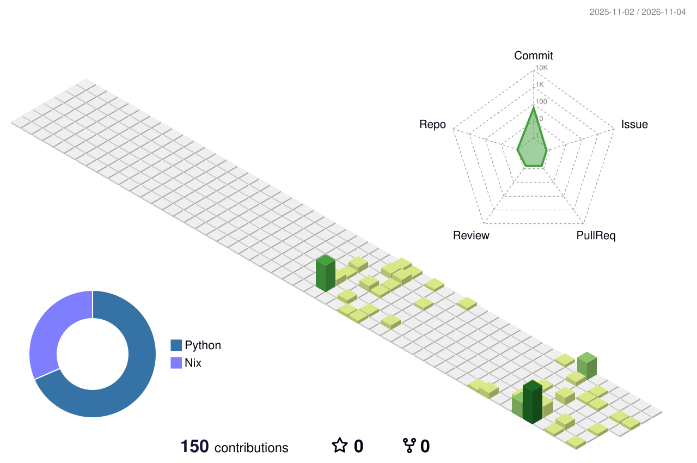

<h1>I'm Johnathan Radojevich 👋 I build production software and model biological systems across time, space, and pharmacology.</h1>

<!-- Scientific Computing -->
<picture>
    <source media="(prefers-color-scheme: light)" srcset="https://img.shields.io/badge/-Python-000000?style=flat-square&logo=python">
    <source media="(prefers-color-scheme: dark)" srcset="https://img.shields.io/badge/-Python-0e1117?style=flat-square&logo=python">
    
</picture>
<picture>
    <source media="(prefers-color-scheme: light)" srcset="https://img.shields.io/badge/-Julia-000000?style=flat-square&logo=julia">
    <source media="(prefers-color-scheme: dark)" srcset="https://img.shields.io/badge/-Julia-0e1117?style=flat-square&logo=julia">
    
</picture>
<picture>
    <source media="(prefers-color-scheme: light)" srcset="https://img.shields.io/badge/-R-000000?style=flat-square&logo=r">
    <source media="(prefers-color-scheme: dark)" srcset="https://img.shields.io/badge/-R-0e1117?style=flat-square&logo=r">
    
</picture>
<picture>
    <source media="(prefers-color-scheme: light)" srcset="https://img.shields.io/badge/-Numpy-000000?style=flat-square&logo=numpy">
    <source media="(prefers-color-scheme: dark)" srcset="https://img.shields.io/badge/-Numpy-0e1117?style=flat-square&logo=numpy">
    
</picture>
<picture>
    <source media="(prefers-color-scheme: light)" srcset="https://img.shields.io/badge/-SciPy-000000?style=flat-square&logo=scipy">
    <source media="(prefers-color-scheme: dark)" srcset="https://img.shields.io/badge/-SciPy-0e1117?style=flat-square&logo=scipy">
    
</picture>
<picture>
    <source media="(prefers-color-scheme: light)" srcset="https://img.shields.io/badge/-Pandas-000000?style=flat-square&logo=pandas">
    <source media="(prefers-color-scheme: dark)" srcset="https://img.shields.io/badge/-Pandas-0e1117?style=flat-square&logo=pandas">
    
</picture>

<!-- Web & Application -->
<picture>
    <source media="(prefers-color-scheme: light)" srcset="https://img.shields.io/badge/-TypeScript-000000?style=flat-square&logo=typescript">
    <source media="(prefers-color-scheme: dark)" srcset="https://img.shields.io/badge/-TypeScript-0e1117?style=flat-square&logo=typescript">
    
</picture>
<picture>
    <source media="(prefers-color-scheme: light)" srcset="https://img.shields.io/badge/-JavaScript-000000?style=flat-square&logo=javascript">
    <source media="(prefers-color-scheme: dark)" srcset="https://img.shields.io/badge/-JavaScript-0e1117?style=flat-square&logo=javascript">
    
</picture>
<picture>
    <source media="(prefers-color-scheme: light)" srcset="https://img.shields.io/badge/-HTML-000000?style=flat-square&logo=htmx">
    <source media="(prefers-color-scheme: dark)" srcset="https://img.shields.io/badge/-HTML-0e1117?style=flat-square&logo=htmx">
    
</picture>
<picture>
    <source media="(prefers-color-scheme: light)" srcset="https://img.shields.io/badge/-CSS-000000?style=flat-square&logo=css">
    <source media="(prefers-color-scheme: dark)" srcset="https://img.shields.io/badge/-CSS-0e1117?style=flat-square&logo=css">
    
</picture>
<picture>
    <source media="(prefers-color-scheme: light)" srcset="https://img.shields.io/badge/-Golang-000000?style=flat-square&logo=go">
    <source media="(prefers-color-scheme: dark)" srcset="https://img.shields.io/badge/-Golang-0e1117?style=flat-square&logo=go">
    
</picture>
<picture>
    <source media="(prefers-color-scheme: light)" srcset="https://img.shields.io/badge/-Java-000000?style=flat-square&logo=coffeescript">
    <source media="(prefers-color-scheme: dark)" srcset="https://img.shields.io/badge/-Java-0e1117?style=flat-square&logo=coffeescript">
    
</picture>

<!-- Infrastructure -->
<picture>
    <source media="(prefers-color-scheme: light)" srcset="https://img.shields.io/badge/-PostgreSQL-000000?style=flat-square&logo=postgresql">
    <source media="(prefers-color-scheme: dark)" srcset="https://img.shields.io/badge/-PostgreSQL-0e1117?style=flat-square&logo=postgresql">
    
</picture>
<picture>
    <source media="(prefers-color-scheme: light)" srcset="https://img.shields.io/badge/-Redis-000000?style=flat-square&logo=redis">
    <source media="(prefers-color-scheme: dark)" srcset="https://img.shields.io/badge/-Redis-0e1117?style=flat-square&logo=redis">
    
</picture>
<picture>
    <source media="(prefers-color-scheme: light)" srcset="https://img.shields.io/badge/-Kafka-000000?style=flat-square&logo=apachekafka">
    <source media="(prefers-color-scheme: dark)" srcset="https://img.shields.io/badge/-Kafka-0e1117?style=flat-square&logo=apachekafka">
    
</picture>
<picture>
    <source media="(prefers-color-scheme: light)" srcset="https://img.shields.io/badge/-Kubernetes-000000?style=flat-square&logo=kubernetes">
    <source media="(prefers-color-scheme: dark)" srcset="https://img.shields.io/badge/-Kubernetes-0e1117?style=flat-square&logo=kubernetes">
    
</picture>
<picture>
    <source media="(prefers-color-scheme: light)" srcset="https://img.shields.io/badge/-Terraform-000000?style=flat-square&logo=terraform">
    <source media="(prefers-color-scheme: dark)" srcset="https://img.shields.io/badge/-Terraform-0e1117?style=flat-square&logo=terraform">
    
</picture>
<picture>
    <source media="(prefers-color-scheme: light)" srcset="https://img.shields.io/badge/-AWS-000000?style=flat-square&logo=icloud">
    <source media="(prefers-color-scheme: dark)" srcset="https://img.shields.io/badge/-AWS-0e1117?style=flat-square&logo=icloud">
    
</picture>
<picture>
    <source media="(prefers-color-scheme: light)" srcset="https://img.shields.io/badge/-Azure-000000?style=flat-square&logo=icloud">
    <source media="(prefers-color-scheme: dark)" srcset="https://img.shields.io/badge/-Azure-0e1117?style=flat-square&logo=icloud">
    
</picture>

<!-- Environment -->
<picture>
    <source media="(prefers-color-scheme: light)" srcset="https://img.shields.io/badge/-Nix-000000?style=flat-square&logo=nixos">
    <source media="(prefers-color-scheme: dark)" srcset="https://img.shields.io/badge/-Nix-0e1117?style=flat-square&logo=nixos">
    
</picture>
<picture>
    <source media="(prefers-color-scheme: light)" srcset="https://img.shields.io/badge/-NixOS-000000?style=flat-square&logo=nixos">
    <source media="(prefers-color-scheme: dark)" srcset="https://img.shields.io/badge/-NixOS-0e1117?style=flat-square&logo=nixos">
    
</picture>
<picture>
    <source media="(prefers-color-scheme: light)" srcset="https://img.shields.io/badge/-Linux-000000?style=flat-square&logo=linux">
    <source media="(prefers-color-scheme: dark)" srcset="https://img.shields.io/badge/-Linux-0e1117?style=flat-square&logo=linux">
    
</picture>
<picture>
    <source media="(prefers-color-scheme: light)" srcset="https://img.shields.io/badge/-MacOS-000000?style=flat-square&logo=apple">
    <source media="(prefers-color-scheme: dark)" srcset="https://img.shields.io/badge/-MacOS-0e1117?style=flat-square&logo=apple">
    
</picture>
<picture>
    <source media="(prefers-color-scheme: light)" srcset="https://img.shields.io/badge/-Vim-000000?style=flat-square&logo=vim">
    <source media="(prefers-color-scheme: dark)" srcset="https://img.shields.io/badge/-Vim-0e1117?style=flat-square&logo=vim">
    
</picture>

<picture>
    <source media="(prefers-color-scheme: dark)" srcset="./profile-3d-contrib/profile-night-rainbow.svg">
    <source media="(prefers-color-scheme: light)" srcset="./profile-3d-contrib/profile-green-animate.svg">
    
</picture>

<h3>💼 Production Software Engineer</h3>
<blockquote>
Shipping software to millions of users taught me that the hardest part is never the code—it’s the underlying model of the system. That realization pulled me out of pure enterprise engineering and toward domains where the model <em>is</em> the point: human physiology, clinical pharmacology, and biological dynamics that don’t wait for a hotfix.
</blockquote>

    Over five years in production software engineering, I’ve designed and shipped distributed systems, full-stack applications, and data infrastructure used by millions of people and processing over $7 billion in revenue. I also hold certifications as a Scrum Master, Product Owner, and Developer.

<h3>🧬 From Distributed Systems to Clinical Medicine</h3>

    Complex biological and epidemiological systems can’t be reasoned about in isolation. Pathogens propagate across space and time; drugs distribute, bind, and clear through coupled physiological compartments; clinical decisions unfold over noisy, longitudinal patient timelines. Capturing those dynamics requires both production-grade computational rigor and deep biochemical and clinical literacy.

    While continuing to work as a software engineer, I am currently completing a <strong>B.S. in Biochemistry (Clinical Pharmacology concentration)</strong> on the pre-medical track—building the wet-lab, physiological, and quantitative foundation for medical school and residency.

<table>
    <thead>
        <tr><th>Stage</th><th>Focus</th><th>Status</th></tr>
    </thead>
    <tbody>
        <tr>
            <td><strong>Industry Engineering</strong></td>
            <td>Distributed Systems, Full-Stack Architecture &amp; Data Pipelines</td>
            <td>Active (5+ Yrs Production)</td>
        </tr>
        <tr>
            <td><strong>Undergraduate Foundation</strong></td>
            <td>B.S. in Biochemistry — <em>Clinical Pharmacology</em> (Pre-Med)</td>
            <td>In Progress</td>
        </tr>
        <tr>
            <td><strong>Medical &amp; Technical Horizon</strong></td>
            <td>M.D. &amp; Residency — Computational Medicine, QSP, or Clinical AI</td>
            <td>Planned</td>
        </tr>
    </tbody>
</table>

    Alongside coursework and engineering, I’m building <a href="https://acidex.com">Acidex</a>—an infrastructure layer for digestive health applications grounded in biochemistry and gastrointestinal physiology rather than surface-level symptom logging.

<picture>
    <source media="(prefers-color-scheme: light)" srcset="logo_light.png">
    <source media="(prefers-color-scheme: dark)"  srcset="logo_dark.png">
    
</picture>

<h3>❄️ Nix &amp; Reproducible Scientific Computing</h3>

    Nix is the only package manager I’ve used that treats reproducibility as an architectural invariant rather than an afterthought. Immutable derivations, referential transparency, and deterministic builds aren’t academic niceties—they are essential in computational biology, pharmacometrics, and clinical AI, where complex toolchains make "works on my machine" a scientific liability. A result you can’t reproduce isn’t a result.

    My daily environment runs macOS as the host for graphical workflows alongside a NixOS VM handling development, numerical modeling, and compilation. You can explore my declarative system configuration <a href="https://github.com/johnathan-radojevich/nome">here</a>.

